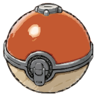
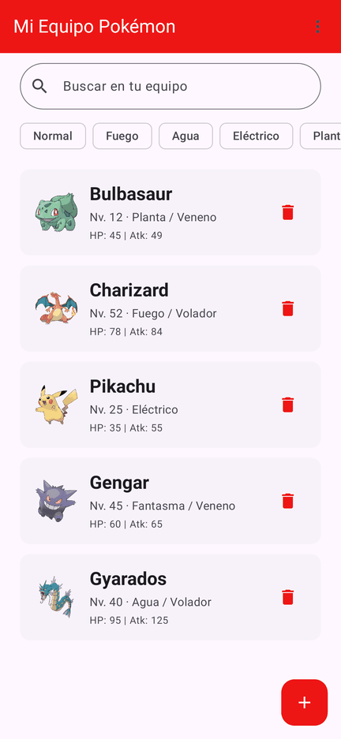
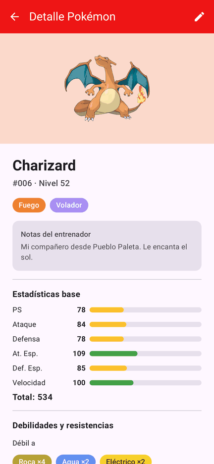
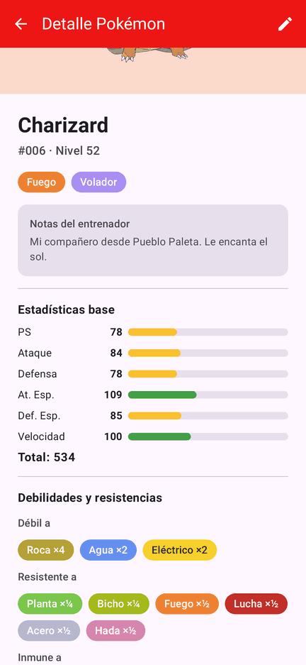
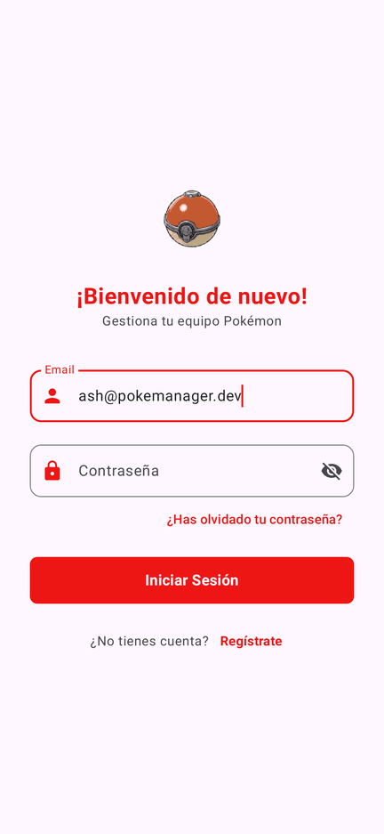
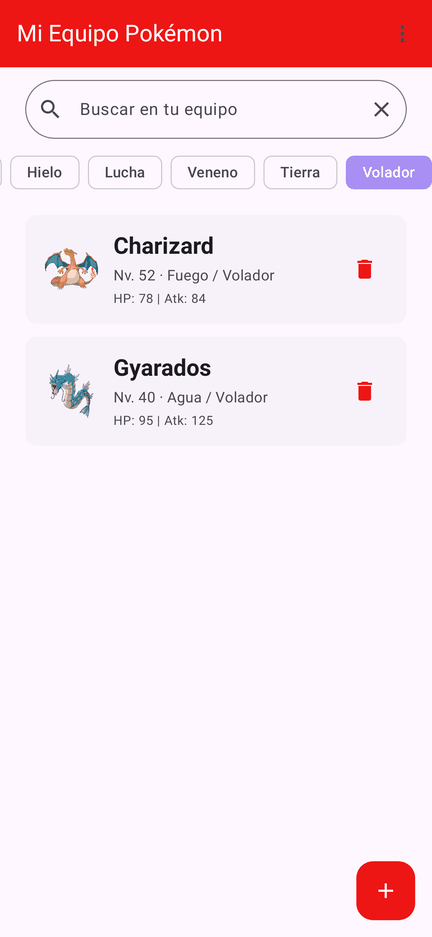
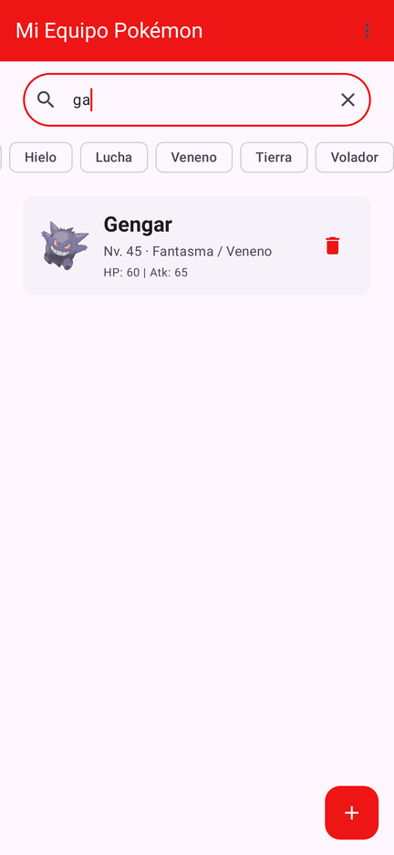
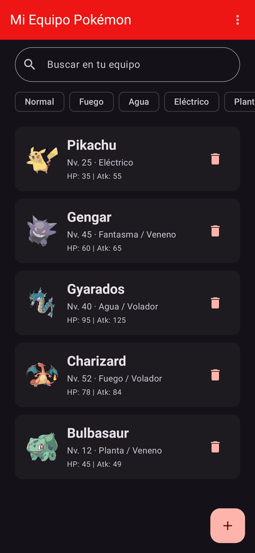
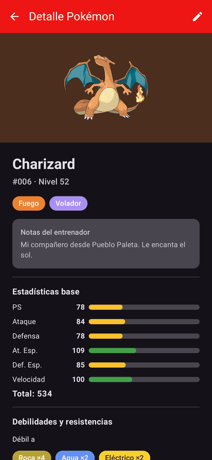
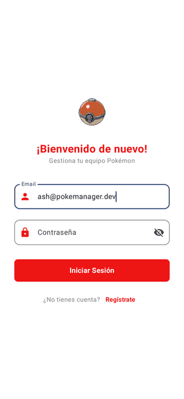

<div align="center">



# PokéManager

**Manage your Pokémon collection on Android: register them, check their profile and learn their weaknesses.**

[Español](README.md) · **English**

[](https://github.com/irilopa/PokeManager/actions/workflows/ci.yml)
[](https://kotlinlang.org/)
[](https://developer.android.com/)
[](https://developer.android.com/compose)
[](https://firebase.google.com/)
[](LICENSE)





</div>

## Contents

- [Features](#features)
- [Screenshots](#screenshots)
- [Tech stack](#tech-stack)
- [Architecture](#architecture)
- [Getting started](#getting-started)
- [Testing](#testing)
- [Data and security](#data-and-security)
- [Project structure](#project-structure)
- [Roadmap](#roadmap)
- [Contributing](#contributing)
- [Author](#author)
- [License](#license)
- [Legal notice](#legal-notice)

## Features

- **Personal account**: sign-up and sign-in with email and password (Firebase Authentication). The session persists across launches and errors are shown in Spanish, the app's interface language.
- **Personal collection**: each user stores their Pokémon in Cloud Firestore, synced in real time.
- **Assisted entry**: when you type a name, the app queries [PokéAPI](https://pokeapi.co/) and fills in the number, types and stats. The form validates the name, level (1–100), types and note length.
- **Search and filters**: search by name (case- and accent-insensitive) combined with a filter for any of the 18 types.
- **Detailed profile**: official artwork, types, level, trainer notes, base stats with bars and total.
- **Weaknesses and resistances**: computed with the type chart (Gen 6+), including dual-type Pokémon (×4, ×2, ×½, ×¼ and immunities).
- **Light and dark mode**: brand colors with WCAG AA contrast in both.
- **Clear states**: loading indicators, error messages with "Retry", a welcome screen when the collection is empty and save confirmation.

## Screenshots

| Sign-in | Collection | Type filter |
| :---: | :---: | :---: |
|  |  |  |

| Search | Detail | Weaknesses |
| :---: | :---: | :---: |
|  |  |  |

| Dark mode: collection | Dark mode: detail |
| :---: | :---: |
|  |  |

<details>
<summary><strong>Watch the animated demo</strong></summary>
<br>
<div align="center">

</div>
</details>

## Tech stack

| Area | Technology |
| --- | --- |
| Language and UI | Kotlin 2.0.21, Jetpack Compose, Material 3, Navigation Compose |
| State and concurrency | ViewModel, Kotlin Coroutines, `StateFlow` |
| Backend | Firebase Authentication, Cloud Firestore |
| External API | PokéAPI with Retrofit, OkHttp and Gson |
| Images | Coil |
| Dependency injection | Koin |
| Testing | JUnit 4, kotlinx-coroutines-test, Robolectric, Compose UI Test, Firebase Emulator Suite |
| Build | Android Gradle Plugin 8.13.2, Gradle 8.13, `minSdk` 26, `targetSdk` 36 |

## Architecture

The app follows **MVVM** with a layered structure inspired by Clean Architecture:

```text
presentation  →  Compose screens + ViewModels (UiState / SaveState)
     │
domain        →  models, repository interfaces, use cases,
     │           form validation, type chart and filters
     │
data          →  Firebase (Auth, Firestore) and PokéAPI (Retrofit) implementations
```

- The domain layer does not depend on Firebase: `AuthRepository` and `PokemonRepository` are interfaces, so ViewModels can be tested with in-memory repositories.
- Screens expose explicit states (`Loading`, `Success`, `Error`) and never show "not found" while loading.
- Logic without Android dependencies (`PokemonFormValidator`, `TypeChart`, `PokemonFilter`) is pure and covered by unit tests.

## Getting started

### Requirements

- Android Studio with support for AGP 8.13 and **JDK 17**.
- Android SDK 36 and a device or emulator running **Android 8.0 (API 26)** or later.
- A [Firebase](https://console.firebase.google.com/) project with Authentication and Cloud Firestore.
- Optional, for the E2E tests: [Firebase CLI](https://firebase.google.com/docs/cli).

### Installation

1. Clone the repository:

   ```bash
   git clone https://github.com/irilopa/PokeManager.git
   ```

2. In the Firebase console, register an Android app with the package `org.ivan.pokmanager`, download `google-services.json` and place it at `app/google-services.json` (replace the existing one if you use your own project).

3. Enable the **Email/Password** provider in Authentication and create a Cloud Firestore database.

4. Deploy the security rules included in the repository:

   ```bash
   firebase deploy --only firestore:rules --project <your-project>
   ```

5. Open the project in Android Studio, sync Gradle and run the `app` configuration. To build from the terminal:

   ```bash
   ./gradlew assembleDebug
   ```

The app needs no environment variables or extra keys: Firebase is configured with `google-services.json` and PokéAPI is public.

### Release

The release build is optimized with R8 and reports crashes to Firebase Crashlytics. On GitHub Actions, the "Build de publicación" job produces an APK to test on a phone on every run and, if the `ANDROID_KEYSTORE_BASE64`, `ANDROID_KEYSTORE_PASSWORD`, `ANDROID_KEY_ALIAS` and `ANDROID_KEY_PASSWORD` secrets are set, the signed AAB for Google Play. The signing key is never stored in the repository.

## Testing

| Type | What it covers | Command |
| --- | --- | --- |
| Unit | Validation, type chart, filters and ViewModels with fake repositories | `./gradlew testDebugUnitTest` |
| End-to-end | Sign-up, sign-in, collection, search, detail and sign-out with the real Firebase SDK | see below |
| README screenshots | Generates the images in `docs/screenshots/` with a sample collection | see below |

Every push to `master` and every pull request runs the build and **the whole suite, including the E2E tests against Firebase Emulator Suite**, on [GitHub Actions](https://github.com/irilopa/PokeManager/actions/workflows/ci.yml). The test report, screenshots and debug APK are kept as artifacts of each run.

The E2E and screenshot tests use Robolectric against **Firebase Emulator Suite**, without touching any real project. If the emulators are not running, they are skipped and the unit suite stays green.

```bash
firebase emulators:exec --only auth,firestore --project pokemanager-6113d \
  "./gradlew testDebugUnitTest --tests '*AppFlowEmulatorTest*'"
```

```bash
firebase emulators:exec --only auth,firestore --project pokemanager-6113d \
  "./gradlew testDebugUnitTest --tests '*ReadmeScreenshotsTest*'"
```

Screenshots are saved to `app/build/e2e-screenshots/`, `app/build/readme-screenshots/` and, in dark mode, `app/build/readme-screenshots-dark/`.

## Data and security

Each user's data lives under their `uid`:

```text
users/{uid}                    profile: name and email
users/{uid}/pokemon/{docId}    Pokémon: name, Pokédex number, types, level,
                               notes, base stats and image
```

The rules in [`firestore.rules`](firestore.rules) only allow the authenticated owner to read and write these documents; any other access is denied. They also validate every write with the same limits as the form (allowed fields, types, level 1–100, lengths and stats 0–255), so invalid data cannot be stored even by bypassing the app. `FirestoreRulesEmulatorTest` checks this against the emulator in CI.

What data is collected, why, and how to delete it is explained in the [privacy policy](docs/privacy.md) (in Spanish).

## Project structure

```text
.
├── app/
│   └── src/
│       ├── main/java/org/ivan/pokmanager/
│       │   ├── data/          # Firebase (Auth, Firestore), PokéAPI and DTOs
│       │   ├── di/            # Koin modules
│       │   ├── domain/        # Models, repositories, use cases, validation, types and filters
│       │   └── presentation/  # Navigation, screens, components, theme and ViewModels
│       └── test/              # Unit tests, E2E tests and screenshot generation
├── docs/                      # README logo, screenshots and demo
├── firebase.json              # Firebase CLI and emulator configuration
├── firestore.rules            # Firestore security rules
├── gradle/libs.versions.toml  # Version catalog
└── LICENSE
```

## Roadmap

- [x] Authentication with persistent session
- [x] Per-user collection with validation and confirmed saving
- [x] Profile with stats, types and weaknesses
- [x] Search and type filter
- [ ] Browse the full Pokédex and add from there
- [ ] Battle teams of up to 6 Pokémon
- [ ] Full type chart (18×18)
- [ ] Side-by-side Pokémon comparison
- [ ] Splash screen and onboarding
- [ ] Offline mode notice

## Contributing

Contributions are welcome:

1. Fork the repository and create a branch from `master` (`git checkout -b feature/my-improvement`).
2. Add or update the relevant tests and make sure `./gradlew testDebugUnitTest` passes.
3. Open a pull request describing the change and include screenshots if it affects the UI.

The README exists in Spanish ([README.md](README.md)) and English (this file). The Spanish version is the source: when a change is merged into `master`, the `README translate` workflow translates the differences with the Claude API and opens a pull request with the updated `README.en.md`. The `README sync` check verifies that both versions keep the same structure.

For bugs or ideas, open an [issue](https://github.com/irilopa/PokeManager/issues). Fixed bugs, with their cause and the test that prevents them from returning, are listed in the [bug history](docs/bugs.md) (in Spanish).

## Author

**Ivan Lopez Rilopa** · Android Developer

Design, architecture and development of PokéManager: a native Kotlin app with Jetpack Compose, a Firebase backend and automated end-to-end tests.

[](https://github.com/irilopa)

Have an opportunity or suggestion? Open an [issue](https://github.com/irilopa/PokeManager/issues) or reach me through my GitHub profile.

## License

Distributed under the **MIT** license. See the [LICENSE](LICENSE) file for details.

The license only covers the source code in this repository; it does not apply to the Pokémon trademarks, names or images mentioned in the legal notice.

## Legal notice

PokéManager is a personal, educational, non-profit project. It is not an official product and is not affiliated with, sponsored or endorsed by Nintendo, The Pokémon Company, Creatures Inc. or GAME FREAK inc.

Pokémon and Pokémon character names are registered trademarks of Nintendo and its affiliates. Pokémon images and data are retrieved from [PokéAPI](https://pokeapi.co/) and belong to their respective owners: © Nintendo, Creatures Inc. and GAME FREAK inc.
