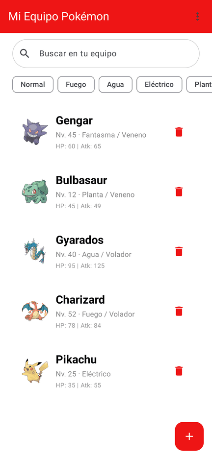
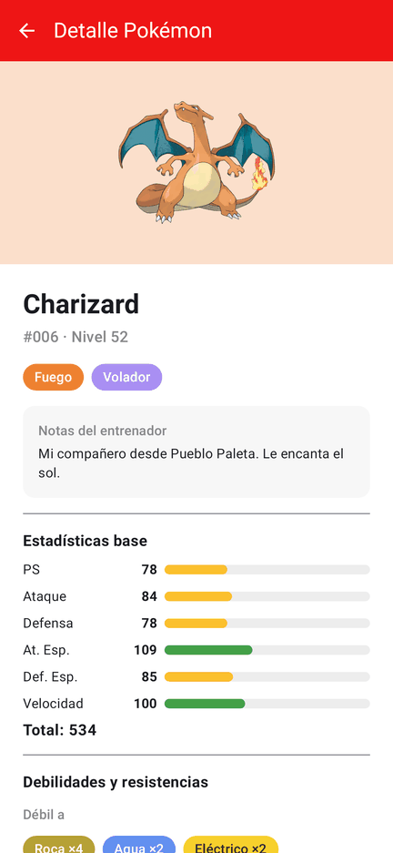
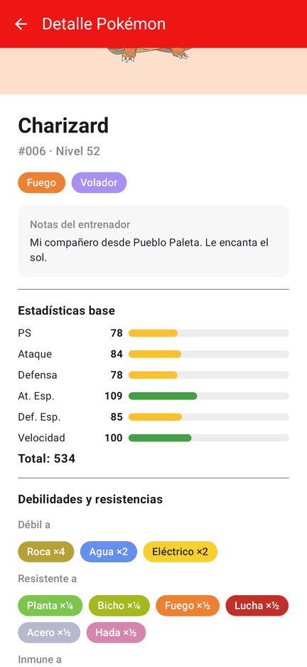
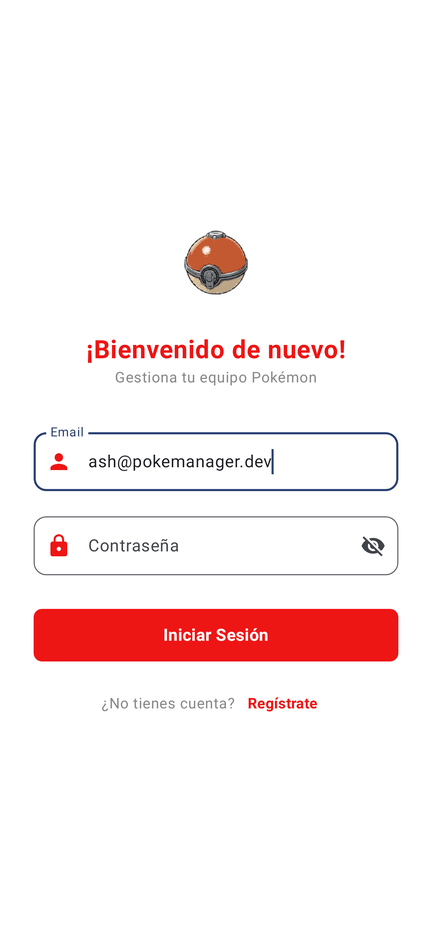
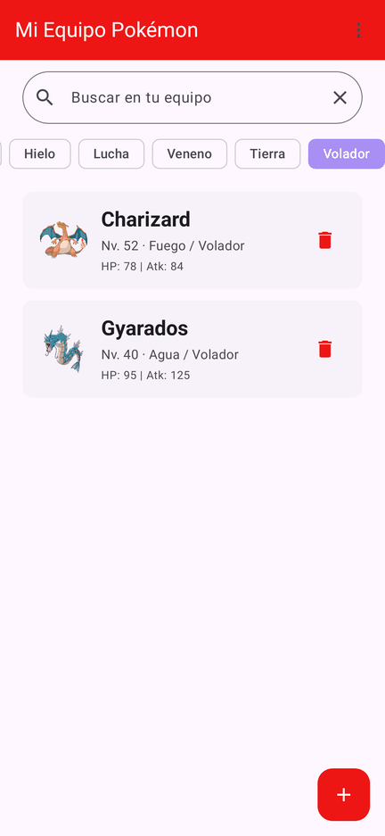
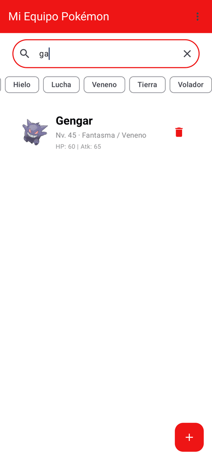
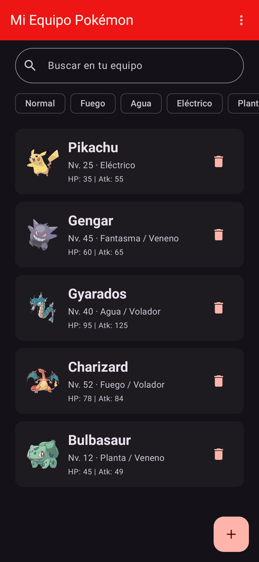
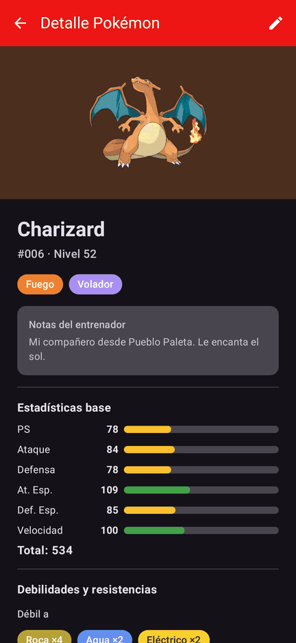
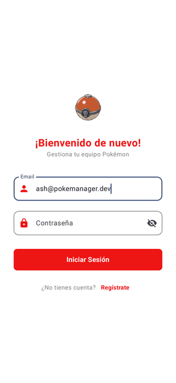

<div align="center">


# PokéManager

**Gestiona tu colección de Pokémon desde Android: regístralos, consulta su ficha y conoce sus debilidades.**

**Español** · [English](README.en.md)

[](https://github.com/irilopa/PokeManager/actions/workflows/ci.yml)
[](https://kotlinlang.org/)
[](https://developer.android.com/)
[](https://developer.android.com/compose)
[](https://firebase.google.com/)
[](LICENSE)





</div>

## Contenido

- [Funcionalidades](#funcionalidades)
- [Capturas](#capturas)
- [Stack tecnológico](#stack-tecnológico)
- [Arquitectura](#arquitectura)
- [Puesta en marcha](#puesta-en-marcha)
- [Pruebas](#pruebas)
- [Datos y seguridad](#datos-y-seguridad)
- [Estructura del proyecto](#estructura-del-proyecto)
- [Hoja de ruta](#hoja-de-ruta)
- [Contribuir](#contribuir)
- [Autor](#autor)
- [Licencia](#licencia)
- [Aviso legal](#aviso-legal)

## Funcionalidades

- **Cuenta propia**: registro e inicio de sesión con email y contraseña (Firebase Authentication). La sesión se mantiene entre aperturas y los errores se muestran en español.
- **Colección personal**: cada usuario guarda sus Pokémon en Cloud Firestore, sincronizados en tiempo real.
- **Alta asistida**: al escribir el nombre, la app consulta la [PokéAPI](https://pokeapi.co/) y rellena número, tipos y estadísticas. El formulario valida nombre, nivel (1–100), tipos y longitud de las notas.
- **Búsqueda y filtros**: búsqueda por nombre (sin distinguir mayúsculas ni tildes) combinable con un filtro por cualquiera de los 18 tipos.
- **Ficha detallada**: imagen oficial, tipos, nivel, notas del entrenador, estadísticas base con barras y total.
- **Debilidades y resistencias**: calculadas con la tabla de tipos (Gen 6+), incluidos los Pokémon de doble tipo (×4, ×2, ×½, ×¼ e inmunidades).
- **Modo claro y oscuro**: colores de la marca con contraste WCAG AA en los dos.
- **Estados claros**: indicadores de carga, mensajes de error con «Reintentar», pantalla de bienvenida cuando la colección está vacía y confirmación al guardar.

## Capturas

| Inicio de sesión | Colección | Filtro por tipo |
| :---: | :---: | :---: |
|  |  |  |

| Búsqueda | Detalle | Debilidades |
| :---: | :---: | :---: |
|  |  |  |

| Modo oscuro: colección | Modo oscuro: detalle |
| :---: | :---: |
|  |  |

<details>
<summary><strong>Ver demo animada</strong></summary>
<br>
<div align="center">

</div>
</details>

## Stack tecnológico

| Área | Tecnología |
| --- | --- |
| Lenguaje y UI | Kotlin 2.0.21, Jetpack Compose, Material 3, Navigation Compose |
| Estado y concurrencia | ViewModel, Kotlin Coroutines, `StateFlow` |
| Backend | Firebase Authentication, Cloud Firestore |
| API externa | PokéAPI con Retrofit, OkHttp y Gson |
| Imágenes | Coil |
| Inyección de dependencias | Koin |
| Pruebas | JUnit 4, kotlinx-coroutines-test, Robolectric, Compose UI Test, Firebase Emulator Suite |
| Compilación | Android Gradle Plugin 8.13.2, Gradle 8.13, `minSdk` 26, `targetSdk` 36 |

## Arquitectura

La app sigue **MVVM** con una separación en capas inspirada en Clean Architecture:

```text
presentation  →  pantallas Compose + ViewModels (UiState / SaveState)
     │
domain        →  modelos, interfaces de repositorio, casos de uso,
     │           validación del formulario, tabla de tipos y filtros
     │
data          →  implementaciones con Firebase (Auth, Firestore) y PokéAPI (Retrofit)
```

- La capa de dominio no depende de Firebase: `AuthRepository` y `PokemonRepository` son interfaces, lo que permite probar los ViewModels con repositorios en memoria.
- Las pantallas exponen estados explícitos (`Loading`, `Success`, `Error`) y nunca muestran «no encontrado» mientras cargan.
- La lógica sin dependencias de Android (`PokemonFormValidator`, `TypeChart`, `PokemonFilter`) es pura y está cubierta por tests unitarios.

## Puesta en marcha

### Requisitos

- Android Studio con soporte para AGP 8.13 y **JDK 17**.
- Android SDK 36 y un dispositivo o emulador con **Android 8.0 (API 26)** o superior.
- Un proyecto de [Firebase](https://console.firebase.google.com/) con Authentication y Cloud Firestore.
- Opcional, para las pruebas E2E: [Firebase CLI](https://firebase.google.com/docs/cli).

### Instalación

1. Clona el repositorio:

   ```bash
   git clone https://github.com/irilopa/PokeManager.git
   ```

2. En Firebase Console, registra una app Android con el paquete `org.ivan.pokmanager`, descarga `google-services.json` y colócalo en `app/google-services.json` (sustituye el existente si usas tu propio proyecto).

3. Activa el proveedor **Correo electrónico/contraseña** en Authentication y crea una base de datos en Cloud Firestore.

4. Publica las reglas de seguridad incluidas en el repositorio:

   ```bash
   firebase deploy --only firestore:rules --project <tu-proyecto>
   ```

5. Abre el proyecto en Android Studio, sincroniza Gradle y ejecuta la configuración `app`. Para compilar desde terminal:

   ```bash
   ./gradlew assembleDebug
   ```

La app no necesita variables de entorno ni claves adicionales: Firebase se configura con `google-services.json` y la PokéAPI es pública.

### Publicación

La versión de publicación se optimiza con R8 y envía los fallos a Firebase Crashlytics. En GitHub Actions, el job «Build de publicación» genera en cada ejecución un APK para probar en un móvil y, si están configurados los secretos `ANDROID_KEYSTORE_BASE64`, `ANDROID_KEYSTORE_PASSWORD`, `ANDROID_KEY_ALIAS` y `ANDROID_KEY_PASSWORD`, el AAB firmado para Google Play. La clave de firma nunca se guarda en el repositorio.

## Pruebas

| Tipo | Qué cubre | Comando |
| --- | --- | --- |
| Unitarias | Validación, tabla de tipos, filtros y ViewModels con repositorios falsos | `./gradlew testDebugUnitTest` |
| Extremo a extremo | Registro, login, colección, búsqueda, detalle y cierre de sesión con el SDK real de Firebase | ver abajo |
| Capturas del README | Genera las imágenes de `docs/screenshots/` con una colección de ejemplo | ver abajo |

Cada push a `master` y cada pull request ejecutan la compilación y **toda la suite, incluidas las pruebas E2E contra Firebase Emulator Suite**, en [GitHub Actions](https://github.com/irilopa/PokeManager/actions/workflows/ci.yml). El informe de tests, las capturas y el APK de depuración quedan como artefactos de cada ejecución.

Las pruebas E2E y de capturas usan Robolectric contra **Firebase Emulator Suite**, sin tocar ningún proyecto real. Si los emuladores no están arrancados, se omiten y la suite unitaria sigue en verde.

```bash
firebase emulators:exec --only auth,firestore --project pokemanager-6113d \
  "./gradlew testDebugUnitTest --tests '*AppFlowEmulatorTest*'"
```

```bash
firebase emulators:exec --only auth,firestore --project pokemanager-6113d \
  "./gradlew testDebugUnitTest --tests '*ReadmeScreenshotsTest*'"
```

Las capturas se guardan en `app/build/e2e-screenshots/`, `app/build/readme-screenshots/` y, en modo oscuro, `app/build/readme-screenshots-dark/`.

## Datos y seguridad

Los datos de cada usuario viven bajo su `uid`:

```text
users/{uid}                    perfil: nombre y email
users/{uid}/pokemon/{docId}    Pokémon: nombre, nº de Pokédex, tipos, nivel,
                               notas, estadísticas base e imagen
```

Las reglas de [`firestore.rules`](firestore.rules) solo permiten leer y escribir estos documentos al usuario autenticado propietario; cualquier otro acceso se deniega. Además validan cada escritura con los mismos límites que el formulario (campos permitidos, tipos, nivel 1–100, longitudes y stats 0–255), así que no se pueden guardar datos inválidos aunque alguien se salte la app. `FirestoreRulesEmulatorTest` lo comprueba contra el emulador en la CI.

Qué datos se recogen, para qué y cómo borrarlos se explica en la [política de privacidad](docs/privacy.md).

## Estructura del proyecto

```text
.
├── app/
│   └── src/
│       ├── main/java/org/ivan/pokmanager/
│       │   ├── data/          # Firebase (Auth, Firestore), PokéAPI y DTO
│       │   ├── di/            # Módulos de Koin
│       │   ├── domain/        # Modelos, repositorios, casos de uso, validación, tipos y filtros
│       │   └── presentation/  # Navegación, pantallas, componentes, tema y ViewModels
│       └── test/              # Tests unitarios, E2E y generación de capturas
├── docs/                      # Logo, capturas y demo del README
├── firebase.json              # Configuración de Firebase CLI y emuladores
├── firestore.rules            # Reglas de seguridad de Firestore
├── gradle/libs.versions.toml  # Catálogo de versiones
└── LICENSE
```

## Hoja de ruta

- [x] Autenticación con sesión persistente
- [x] Colección por usuario con validación y guardado confirmado
- [x] Ficha con estadísticas, tipos y debilidades
- [x] Búsqueda y filtro por tipo
- [ ] Explorar el Pokédex completo y añadir desde ahí
- [ ] Equipos de combate de hasta 6 Pokémon
- [ ] Tabla de tipos completa (18×18)
- [ ] Comparador de dos Pokémon
- [ ] Splash screen y onboarding
- [ ] Aviso de modo sin conexión

## Contribuir

Las contribuciones son bienvenidas:

1. Haz un fork y crea una rama desde `master` (`git checkout -b feature/mi-mejora`).
2. Añade o actualiza los tests correspondientes y comprueba que `./gradlew testDebugUnitTest` pasa.
3. Abre un pull request: la plantilla te pide qué cambia, cómo se ha probado y una lista de comprobación. Si afecta a la interfaz, incluye capturas.

El README existe en español (este archivo) y en inglés ([README.en.md](README.en.md)). La versión en español es la fuente: al fusionar un cambio en `master`, el workflow `README translate` traduce las diferencias con la API de Claude y abre un pull request con `README.en.md` actualizado. La comprobación `README sync` verifica que ambas versiones mantienen la misma estructura.

Para errores o propuestas, abre un [issue](https://github.com/irilopa/PokeManager/issues/new/choose) con la plantilla de bug o de mejora. Los bugs corregidos, con su causa y el test que evita que vuelvan, están en el [historial de bugs](docs/bugs.md).

## Autor

**Ivan Lopez Rilopa** · Desarrollador Android

Diseño, arquitectura y desarrollo de PokéManager: app nativa en Kotlin con Jetpack Compose, backend en Firebase y pruebas automatizadas de extremo a extremo.

[](https://github.com/irilopa)

¿Tienes una oportunidad o sugerencia? Abre un [issue](https://github.com/irilopa/PokeManager/issues) o contáctame a través de mi perfil de GitHub.

## Licencia

Distribuido bajo la licencia **MIT**. Consulta el archivo [LICENSE](LICENSE) para más información.

La licencia cubre únicamente el código fuente de este repositorio; no se aplica a las marcas, nombres ni imágenes de Pokémon mencionados en el aviso legal.

## Aviso legal

PokéManager es un proyecto personal, educativo y sin ánimo de lucro. No es un producto oficial ni está afiliado, patrocinado ni respaldado por Nintendo, The Pokémon Company, Creatures Inc. ni GAME FREAK inc.

Pokémon y los nombres de los Pokémon son marcas registradas de Nintendo y sus filiales. Las imágenes y los datos de los Pokémon se obtienen de [PokéAPI](https://pokeapi.co/) y pertenecen a sus respectivos titulares: © Nintendo, Creatures Inc. y GAME FREAK inc.
